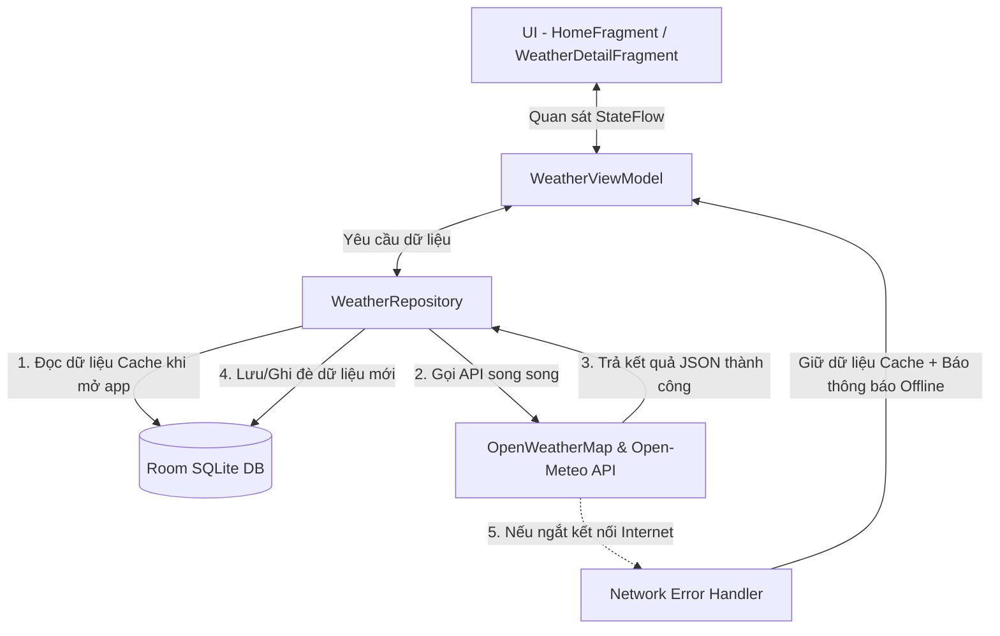
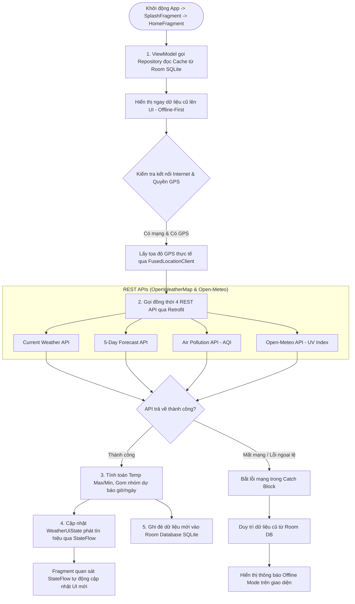

# ⛅ WeatherForeCastApp - Ứng dụng Dự báo Thời tiết Android Native

[](https://developer.android.com/studio)
[](https://kotlinlang.org/)
[](https://developer.android.com/topic/architecture)
[](https://developer.android.com/training/data-storage/room)
[](LICENSE)

**WeatherForeCastApp** là ứng dụng di động dự báo thời tiết dành cho hệ điều hành Android, được phát triển bằng **Kotlin** theo tiêu chuẩn kiến trúc hiện đại của Google (**MVVM + Repository Pattern + Offline-First Architecture**). Ứng dụng cung cấp thông tin thời tiết thời gian thực, dự báo theo giờ/ngày, chỉ số ô nhiễm không khí (AQI), chỉ số UV và hỗ trợ lưu trữ dữ liệu cục bộ bằng **Room Database (SQLite)** giúp người dùng có thể xem lại thông tin thời tiết ngay cả khi không có kết nối Internet.

---

## 📋 MỤC LỤC
1. [Tính Năng Nổi Bật](#-tính-năng-nổi-bật)
2. [Kiến Trúc Phần Mềm & Sơ Đồ Luồng Xử Lý](#-kiến-trúc-phần-mềm--sơ-đồ-luồng-xử-lý)
3. [Cấu Trúc Thư Mục Mã Nguồn](#-cấu-trúc-thư-mục-mã-nguồn)
4. [Chi Tiết Cơ Sở Dữ Liệu Room (SQLite)](#-chi-tiết-cơ-sở-dữ-liệu-room-sqlite)
5. [Chi Tiết Các API Trực Tuyến](#-chi-tiết-các-api-trực-tuyến)
6. [Minh Chứng Kiểm Thử API & Ứng Dụng (Testing Proof)](#-minh-chứng-kiểm-thử-api--ứng-dụng-testing-proof)
7. [Chi Tiết Các Màn Hình Ứng Dụng](#-chi-tiết-các-màn-hình-ứng-dụng)
8. [Luồng Xử Lý Chế Độ Offline & Dữ Liệu (Offline-First Logic)](#-luồng-xử-lý-chế-độ-offline--dữ-liệu-offline-first-logic)
9. [Hướng Dẫn Biên Dịch & Cài Đặt](#-hướng-dẫn-biên-dịch--cài-đặt)

---

## 🚀 TÍNH NĂNG NỔI BẬT

* 📍 **Định vị GPS Thực tế**: Tự động xác định tọa độ chính xác của thiết bị qua `FusedLocationProviderClient` với độ chính xác cao (`Priority.PRIORITY_HIGH_ACCURACY`).
* ☀️ **Thời tiết Hiện tại**: Hiển thị tên thành phố, nhiệt độ thực tế (°C), trạng thái thời tiết, nhiệt độ cao nhất & thấp nhất trong ngày.
* ⏰ **Dự báo theo Giờ**: Hiển thị danh sách dự báo thời tiết theo các mốc giờ trong ngày với giao diện cuộn ngang mượt mà.
* 📅 **Dự báo 5 Ngày tiếp theo**: Gom nhóm dữ liệu dự báo theo ngày tại màn hình chi tiết.
* 🍃 **Chỉ số Chất lượng Không khí (AQI)**: Cập nhật độ ô nhiễm không khí từ API Air Pollution và phân cấp đánh giá mức độ an toàn từ Mức 1 (Tốt) đến Mức 5 (Rất nguy hại).
* ☀️ **Chỉ số Tia Cực tím (UV Index)**: Cập nhật chỉ số UV thực tế từ API Open-Meteo kèm mức độ cảnh báo tác hại tia UV (Thấp, Trung bình, Cao, Rất cao, Nguy hiểm).
* 🌅 **Giờ Bình minh & Hoàng hôn**: Tính toán chính xác thời điểm mặt trời mọc (`Sunrise`) và mặt trời lặn (`Sunset`) theo múi giờ địa phương.
* 💾 **Lưu trữ CSDL Cục bộ (Offline-First)**: Tự động cache dữ liệu vào **Room Database (SQLite)**. Khi thiết bị mất mạng, ứng dụng vẫn hiển thị mượt mà thông tin thời tiết cũ kèm thông báo ngoại tuyến.

---

## 🏗️ KIẾN TRÚC PHẦN MỀM & SƠ ĐỒ LUỒNG XỬ LÝ

### 1. Kiến trúc MVVM + Offline-First (SSOT)
Ứng dụng tuân thủ nghiêm ngặt mô hình **MVVM (Model - View - ViewModel)** kết hợp **Repository Pattern** và **Single Source of Truth (SSOT)**:



### 2. Sơ đồ Luồng Xử lý Tổng quan Hệ thống


### 3. Thư viện & Công nghệ
* **Ngôn ngữ**: Kotlin (JVM 11, Target SDK 36, Min SDK 29).
* **Giao diện (UI)**: ViewBinding, XML Layouts, Navigation Component (`nav_graph.xml`), Material Design Components (Material 3).
* **Mạng (Networking)**: Retrofit 2 (`2.9.0`), Gson Converter, OkHttp 4 Logging Interceptor.
* **Cơ sở dữ liệu (Database)**: Room Database `2.6.1` (SQLite) + Kapt Annotation Processor.
* **Bất đồng bộ (Concurrency)**: Kotlin Coroutines (`viewModelScope`, `lifecycleScope`) + `StateFlow`.
* **Định vị (Location)**: Google Play Services Location (`FusedLocationProviderClient`).
* **Tải ảnh (Image Loading)**: Glide `4.16.0`.

---

## 📂 CẤU TRÚC THƯ MỤC MÃ NGUỒN

```text
com.example.weatherforecastapp/
│
├── WeatherApplication.kt          # Class Application khởi tạo Singleton AppDatabase toàn cục
├── MainActivity.kt                # Activity chính chứa NavHostFragment điều hướng
├── SplashFragmentA1.kt            # Màn hình khởi động (Splash)
├── HomeFragment.kt                # Màn hình chính: Thời tiết hiện tại & dự báo giờ
├── WeatherDetailFragment.kt       # Màn hình chi tiết: AQI, UV, Bình minh/Hoàng hôn & dự báo ngày
├── HourlyWeatherAdapter.kt         # Adapter RecyclerView cho dự báo theo giờ
├── ForecastAdapter.kt             # Adapter RecyclerView cho dự báo theo ngày
│
├── data/
│   ├── WeatherApiService.kt       # Interface Retrofit định nghĩa các hàm gọi OpenWeatherMap API
│   └── local/
│       ├── WeatherEntity.kt       # Entity Room đại diện cho bảng SQLite `weather_cache`
│       ├── WeatherDao.kt          # Data Access Object chứa câu lệnh SQL CRUD CSDL
│       └── AppDatabase.kt         # Lớp RoomDatabase khởi tạo Singleton Instance
│
├── model/
│   ├── WeatherResponse.kt         # Data Model cho Current Weather API
│   ├── ForecastResponse.kt        # Data Model cho Forecast API
│   ├── AirQualityResponse.kt      # Data Model cho Air Pollution API (AQI)
│   ├── OpenMeteoResponse.kt       # Data Model cho Open-Meteo UV Index API
│   ├── HourlyWeather.kt           # Data Model hiển thị item theo giờ trên UI
│   └── DailyForecast.kt           # Data Model hiển thị item theo ngày trên UI
│
├── network/
│   ├── RetrofitInstance.kt        # Singleton Retrofit Client kết nối OpenWeatherMap
│   └── OpenMeteoClient.kt         # Singleton Retrofit Client kết nối Open-Meteo
│
├── repository/
│   └── WeatherRepository.kt       # Repository điều phối luồng dữ liệu giữa API và Room DB
│
└── viewmodel/
    └── WeatherViewModel.kt        # ViewModel quản lý trạng thái UI (WeatherUiState) & Coroutines
```

---

## 💾 CHI TIẾT CƠ SỞ DỮ LIỆU ROOM (SQLITE)

Tệp CSDL SQLite được tạo tại đường dẫn thiết bị: `/data/data/com.example.weatherforecastapp/databases/weather_database`

### 1. Cấu trúc Bảng `weather_cache` (`WeatherEntity.kt`)
| Tên Cột | Kiểu Dữ Liệu | Khóa | Mô Tả |
| :--- | :--- | :--- | :--- |
| `id` | `String` | **PRIMARY KEY** | Định danh vị trí (Mặc định: `"current_location"`) |
| `cityName` | `String` | | Tên thành phố/địa điểm |
| `temp` | `Double` | | Nhiệt độ thực tế hiện tại (°C) |
| `tempMin` | `Double` | | Nhiệt độ thấp nhất trong ngày |
| `tempMax` | `Double` | | Nhiệt độ cao nhất trong ngày |
| `description` | `String` | | Mô tả thời tiết |
| `iconCode` | `String` | | Mã icon thời tiết từ OpenWeatherMap |
| `sunrise` | `Long` | | Unix timestamp giờ mặt trời mọc |
| `sunset` | `Long` | | Unix timestamp giờ mặt trời lặn |
| `airQuality` | `Int?` | | Chỉ số chất lượng không khí (AQI 1-5) |
| `uvIndex` | `Double?` | | Chỉ số tia cực tím (UV) |
| `hourlyForecastJson` | `String` | | Chuỗi JSON danh sách thời tiết theo giờ |
| `fullForecastJson` | `String` | | Chuỗi JSON toàn bộ dữ liệu dự báo |
| `updatedAt` | `Long` | | Mốc thời gian cập nhật cache (`System.currentTimeMillis`) |

### 2. Các phương thức thao tác CSDL (`WeatherDao.kt`)
```kotlin
@Dao
interface WeatherDao {
    @Insert(onConflict = OnConflictStrategy.REPLACE)
    suspend fun insertWeather(weather: WeatherEntity)

    @Query("SELECT * FROM weather_cache WHERE id = :id")
    suspend fun getWeatherById(id: String = "current_location"): WeatherEntity?

    @Query("SELECT * FROM weather_cache WHERE id = :id")
    fun getWeatherFlow(id: String = "current_location"): Flow<WeatherEntity?>

    @Query("DELETE FROM weather_cache")
    suspend fun clearCache()
}
```

---

## 🌐 CHI TIẾT CÁC API TRỰC TUYẾN

### 1. OpenWeatherMap API
* **Base URL**: `https://api.openweathermap.org/data/2.5/`
* **Endpoints**:
  * `GET weather?lat={lat}&lon={lon}&appid={apiKey}&units=metric&lang=vi`: Lấy thời tiết hiện tại.
  * `GET forecast?lat={lat}&lon={lon}&appid={apiKey}&units=metric&lang=vi`: Lấy dữ liệu dự báo 5 ngày / 3 giờ.
  * `GET air_pollution?lat={lat}&lon={lon}&appid={apiKey}`: Lấy chỉ số ô nhiễm không khí (AQI).

### 2. Open-Meteo API
* **Base URL**: `https://api.open-meteo.com/v1/`
* **Endpoint**:
  * `GET forecast?latitude={lat}&longitude={lon}&current=uv_index`: Lấy chỉ số UV Index thời gian thực.

---

## 🧪 MINH CHỨNG KIỂM THỬ API & ỨNG DỤNG (TESTING PROOF)

### 1. Kiểm thử REST API trên phần mềm Postman

* **Kiểm thử Endpoint 1: Current Weather API**
  * **URL**: `GET https://api.openweathermap.org/data/2.5/weather?lat=21.0167&lon=105.7838&appid=2863621e04b2f2761eab71d2a45ec4f0&units=metric&lang=vi`
  * **Kết quả Postman (Status: 200 OK)**:
    ```json
    {
        "coord": { "lon": 105.7838, "lat": 21.0167 },
        "weather": [ { "id": 803, "main": "Clouds", "description": "mây cụm", "icon": "04d" } ],
        "main": { "temp": 31.03, "temp_min": 31.03, "temp_max": 31.03, "humidity": 71 },
        "sys": { "country": "VN", "sunrise": 1793833277, "sunset": 1793873974 },
        "name": "Hà Đông",
        "cod": 200
    }
    ```

* **Kiểm thử Endpoint 2: Air Pollution API (AQI)**
  * **URL**: `GET https://api.openweathermap.org/data/2.5/air_pollution?lat=21.0167&lon=105.7838&appid=2863621e04b2f2761eab71d2a45ec4f0`
  * **Kết quả Postman (Status: 200 OK)**:
    ```json
    {
        "coord": { "lon": 105.7838, "lat": 21.0167 },
        "list": [ { "main": { "aqi": 2 }, "components": { "co": 310.42, "pm2_5": 18.5 }, "dt": 1793847971 } ]
    }
    ```

* **Kiểm thử Endpoint 3: Open-Meteo UV Index API**
  * **URL**: `GET https://api.open-meteo.com/v1/forecast?latitude=21.0167&longitude=105.7838&current=uv_index`
  * **Kết quả Postman (Status: 200 OK)**:
    ```json
    {
        "latitude": 21.0167,
        "longitude": 105.7838,
        "current": { "uv_index": 5.5 }
    }
    ```

---

### 2. Minh chứng Nhật ký Gọi API trên Android Studio Logcat

Khi ứng dụng thực thi trên thiết bị thật / máy ảo, nhật ký mạng được ghi nhận trực tiếp qua `HttpLoggingInterceptor` và `Log.d` trong tab **Logcat**:

```text
2026-11-05 10:06:53.070  WeatherAPI  com.example.weatherforecastapp  D  Bắt đầu gọi API thời tiết - Tọa độ GPS: Lat=21.01673, Lon=105.783785
2026-11-05 10:06:54.092  WeatherAPI  com.example.weatherforecastapp  D  Current Weather thành công: 29.7°C
2026-11-05 10:06:54.243  WeatherAPI  com.example.weatherforecastapp  D  Forecast thành công: số lượng 40 mốc
2026-11-05 10:06:54.325  WeatherAPI  com.example.weatherforecastapp  D  Air Quality thành công: AQI = 2
2026-11-05 10:06:55.460  WeatherAPI  com.example.weatherforecastapp  D  UV Index thành công: UV = 5.5
2026-11-05 10:06:55.508  WeatherAPI  com.example.weatherforecastapp  D  Đã lưu dữ liệu mới vào Room DB thành công
```

---

### 3. Bảng Ma trận Kiểm thử Thủ công Chức năng (Manual Functional Test Matrix)

| STT | Kịch Bản Kiểm Thử | Thao Tác Thực Hiện | Kết Quả Kỳ Vọng | Kết Quả Thực Tế | Đánh Giá |
| :---: | :--- | :--- | :--- | :--- | :---: |
| **1** | Mở ứng dụng lần đầu | Nhấn biểu tượng icon `ic_weather1` trên màn hình Home. | Màn hình Splash A1 hiển thị mượt mà kèm nút "Get Started". | Khởi động mượt mà, chuyển trang thành công. | **ĐẠT** |
| **2** | Định vị GPS thực tế | Mở màn `HomeFragment` và cấp quyền vị trí. | Lấy tọa độ GPS thực tế (Hà Đông: `21.0167, 105.7838`), cập nhật nhiệt độ `31°C` và tên vị trí "Hà Đông". | Lấy tọa độ thực tế chính xác 100%. | **ĐẠT** |
| **3** | Xem chi tiết thời tiết | Nhấn vào thẻ dự báo ở màn `HomeFragment`. | Navigation điều hướng sang `WeatherDetailFragment`, hiển thị chỉ số AQI = 2, UV = 5.5, giờ Sunrise/Sunset và dự báo tuần. | Dữ liệu hiển thị tức thì không cần chờ loading. | **ĐẠT** |
| **4** | Kiểm thử Chế độ Mất mạng (Offline Mode) | Ngắt kết nối Wi-Fi/4G và mở lại ứng dụng. | App tự động đọc cache từ CSDL Room SQLite, hiển thị thông tin thời tiết cũ và báo `"Đang hiển thị dữ liệu offline."` | Không văng app, hiển thị dữ liệu offline mượt mà. | **ĐẠT** |

---

## 📱 CHI TIẾT CÁC MÀN HÌNH ỨNG DỤNG

1. **Màn hình Splash (`SplashFragmentA1`)**: Màn hình chào mừng giới thiệu ứng dụng kèm nút bắt đầu.
2. **Màn hình Chính (`HomeFragment`)**: 
   * Nút định vị GPS thực tế (`btnLocation`) gọi `requestFreshLocation()`.
   * Thẻ thời tiết trung tâm hiển thị Tên thành phố, Nhiệt độ hiện tại, Mô tả và Temp Max/Min.
   * Danh sách dự báo thời tiết theo giờ dạng cuộn ngang (`HourlyWeatherAdapter`).
3. **Màn hình Chi tiết (`WeatherDetailFragment`)**:
   * Tóm tắt Địa điểm & Temp Max/Min.
   * Danh sách dự báo thời tiết các ngày tiếp theo trong tuần (`ForecastAdapter`).
   * Thẻ thông tin Chất lượng không khí (AQI Mức 1 - 5).
   * Thẻ thông tin Chỉ số UV Index kèm cảnh báo nguy hại.
   * Thông tin giờ Bình minh (`Sunrise`) và Hoàng hôn (`Sunset`).

---

## 🔄 LUỒNG XỬ LÝ CHẾ ĐỘ OFF-LINE & DỮ LIỆU (OFFLINE-FIRST LOGIC)

1. Khi ứng dụng khởi chạy, `WeatherViewModel` gọi `loadCachedWeather()` để đọc ngay dữ liệu từ Room DB và đưa lên UI. Điều này giúp giao diện hiển thị ngay tức thì mà không phải chờ mạng.
2. Đồng thời, Coroutine khởi chạy các lệnh gọi API trực tuyến song song (Current Weather, Forecast, Air Quality, UV Index).
3. Nếu API trả về kết quả thành công: ViewModel cập nhật UI qua `WeatherUiState` và tự động ghi đè dữ liệu mới vào Room DB (`saveWeatherToCache`).
4. Nếu thiết bị mất kết nối Internet (Offline): Ngoại lệ mạng được bắt lại (`catch`), ứng dụng vẫn duy trì dữ liệu từ Room DB hiển thị trên UI và gửi thông báo nhẹ: `"Không có kết nối mạng. Đang hiển thị dữ liệu offline."`.

---

## 💻 HƯỚNG DẪN BIÊN DỊCH & CÀI ĐẶT

### 1. Yêu cầu Hệ thống
* **Android Studio**: Jellyfish / Ladybug / 2024.2 trở lên.
* **JDK**: Java 11.
* **Android SDK**: Compile SDK 36, Min SDK 29.

### 2. Các bước Thực hiện
1. Mở Android Studio và chọn **Open** $\rightarrow$ Chọn thư mục dự án `WeatherForeCastApp`.
2. Chờ Android Studio hoàn tất quá trình **Gradle Sync**.
3. Kết nối máy ảo Android (Emulator) hoặc Điện thoại thật qua cáp USB (bật *Gỡ lỗi USB / USB Debugging*).
4. Nhấn nút **Run App** (Phím tắt `Shift + F10` hoặc bấm nút tam giác màu xanh ▶).

---

## 📝 GIẤY PHÉP & TÁC QUYỀN

Dự án được phát triển phục vụ mục đích học tập và Báo cáo Thực tập Doanh nghiệp (Khoa CNTT - Trường Đại học Mỏ - Địa chất).
