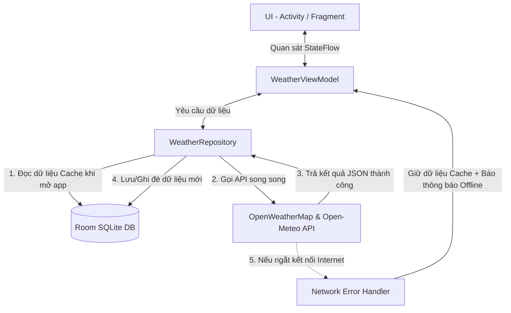

# ⛅ WeatherForeCastApp - Ứng dụng Dự báo Thời tiết Android Native

[](https://developer.android.com/studio)
[](https://kotlinlang.org/)
[](https://developer.android.com/topic/architecture)
[](LICENSE)

**WeatherForeCastApp** là ứng dụng di động dự báo thời tiết dành cho hệ điều hành Android, được phát triển bằng **Kotlin** theo tiêu chuẩn kiến trúc hiện đại của Google (**MVVM + Repository Pattern + Offline-First Architecture**). Ứng dụng cung cấp thông tin thời tiết thời gian thực, dự báo theo giờ/ngày, chỉ số ô nhiễm không khí (AQI), chỉ số UV và hỗ trợ lưu trữ dữ liệu cục bộ bằng **Room Database (SQLite)** giúp người dùng có thể xem lại thông tin thời tiết ngay cả khi không có kết nối Internet.

---

## 🚀 Các Tính Năng Chính

* 📍 **Định vị GPS Thực tế**: Tự động xác định tọa độ chính xác của thiết bị qua `FusedLocationProviderClient` với độ chính xác cao (`Priority.PRIORITY_HIGH_ACCURACY`).
* ☀️ **Thời tiết Hiện tại**: Hiển thị tên thành phố, nhiệt độ thực tế (°C), trạng thái thời tiết, nhiệt độ cao nhất & thấp nhất trong ngày.
* ⏰ **Dự báo theo Giờ**: Hiển thị danh sách dự báo thời tiết theo các mốc giờ trong ngày với giao diện cuộn ngang mượt mà.
* 📅 **Dự báo 5 Ngày tiếp theo**: Gom nhóm dữ liệu dự báo theo ngày tại màn hình chi tiết.
* 🍃 **Chỉ số Chất lượng Không khí (AQI)**: Cập nhật độ ô nhiễm không khí từ API Air Pollution và phân cấp đánh giá mức độ an toàn (Tốt, Trung bình, Kém, Nguy hại).
* ☀️ **Chỉ số Tia Cực tím (UV Index)**: Cập nhật chỉ số UV thực tế từ API Open-Meteo kèm mức độ cảnh báo tác hại tia UV.
* 🌅 **Giờ Bình minh & Hoàng hôn**: Tính toán chính xác thời điểm mặt trời mọc (`Sunrise`) và mặt trời lặn (`Sunset`).
* 💾 **Lưu trữ CSDL Cục bộ (Offline-First)**: Tự động cache dữ liệu vào **Room Database (SQLite)**. Khi thiết bị mất mạng, ứng dụng vẫn hiển thị mượt mà thông tin thời tiết cũ kèm thông báo ngoại tuyến.

---

## 🏗️ Kiến Trúc & Công Nghệ (Tech Stack)

### 1. Kiến trúc phần mềm
Ứng dụng tuân thủ nghiêm ngặt mô hình **MVVM (Model - View - ViewModel)** kết hợp **Repository Pattern** và **Single Source of Truth (SSOT)**:



### 2. Thư viện & Công nghệ
* **Ngôn ngữ**: Kotlin (JVM 11, Target SDK 36, Min SDK 29).
* **Giao diện (UI)**: ViewBinding, XML Layouts, Navigation Component (`nav_graph.xml`), Material Design Components.
* **Mạng (Networking)**: Retrofit 2, Gson Converter, OkHttp 4 Logging Interceptor.
* **Cơ sở dữ liệu (Database)**: Room Database `2.6.1` (SQLite) + Kapt Annotation Processor.
* **Bất đồng bộ (Concurrency)**: Kotlin Coroutines (`viewModelScope`, `lifecycleScope`) + `StateFlow`.
* **Định vị (Location)**: Google Play Services Location (`FusedLocationProviderClient`).
* **Tải ảnh (Image Loading)**: Glide `4.16.0`.

### 3. Nguồn API Trực tuyến
* **OpenWeatherMap API**:
  * `weather`: Thời tiết hiện tại, nhiệt độ min/max, bình minh/hoàng hôn.
  * `forecast`: Dự báo 5 ngày / 3 giờ.
  * `air_pollution`: Chỉ số chất lượng không khí (AQI).
* **Open-Meteo API**:
  * `v1/forecast`: Chỉ số UV Index thời gian thực.

---

## 📂 Cấu Trúc Thư Mục Dự Án

```text
com.example.weatherforecastapp/
│
├── WeatherApplication.kt          # Class Application khởi tạo Singleton AppDatabase toàn cục
├── MainActivity.kt                # Activity chính chứa NavHostFragment điều hướng
├── SplashFragmentA1.kt            # Màn hình khởi động (Splash A1)
├── A2Fragment.kt                  # Màn hình chính (A2): Thời tiết hiện tại & dự báo giờ
├── A3Fragment.kt                  # Màn hình chi tiết (A3): AQI, UV, Bình minh/Hoàng hôn & dự báo ngày
├── HourlyWeatherAdapter.kt         # Adapter RecyclerView cho dự báo theo giờ màn A2
├── ForecastAdapter.kt             # Adapter RecyclerView cho dự báo theo ngày màn A3
│
├── data/
│   ├── WeatherApiService.kt       # Interface Retrofit định nghĩa các hàm gọi OpenWeatherMap API
│   └── local/
│       ├── WeatherEntity.kt       # Entity Room đại diện cho bảng SQLite `weather_cache`
│       ├── WeatherDao.kt          # Data Access Object chứa câu lệnh SQL CRUD CSDL
│       └── AppDatabase.kt         # Lớp RoomDatabase khởi tạo Singleton Instance
│
├── model/
│   ├── WeatherResponse.kt         # Data Model cho Current Weather API
│   ├── ForecastResponse.kt        # Data Model cho Forecast API
│   ├── AirQualityResponse.kt      # Data Model cho Air Pollution API (AQI)
│   ├── OpenMeteoResponse.kt       # Data Model cho Open-Meteo UV Index API
│   ├── HourlyWeather.kt           # Data Model hiển thị item theo giờ trên UI
│   └── Forecast.kt                # Data Model hiển thị item theo ngày trên UI
│
├── network/
│   ├── RetrofitInstance.kt        # Singleton Retrofit Client kết nối OpenWeatherMap
│   └── OpenMeteoClient.kt         # Singleton Retrofit Client kết nối Open-Meteo
│
├── repository/
│   └── WeatherRepository.kt       # Repository điều phối luồng dữ liệu giữa API và Room DB
│
└── viewmodel/
    └── WeatherViewModel.kt        # ViewModel quản lý trạng thái UI (WeatherUiState) & Coroutines
```

---

## 💻 Hướng Dẫn Biên Dịch & Chạy Ứng Dụng

### 1. Yêu cầu Hệ thống
* **Android Studio**: Jellyfish / Ladybug / 2024.2 trở lên.
* **JDK**: Java 11.
* **Android SDK**: Compile SDK 36, Min SDK 29.

### 2. Các bước Thực hiện
1. Mở Android Studio và chọn **Open** $\rightarrow$ Chọn thư mục dự án `WeatherForeCastApp`.
2. Chờ Android Studio hoàn tất quá trình **Gradle Sync**.
3. Kết nối máy ảo Android (Emulator) hoặc Điện thoại thật qua cáp USB (bật *Gỡ lỗi USB / USB Debugging*).
4. Nhấn nút **Run App** (Phím tắt `Shift + F10` hoặc bấm nút tam giác màu xanh ▶).

---

## 📝 Giấy Phép & Tác Quyền

Dự án được phát triển phục vụ mục đích học tập và Báo cáo Thực tập Doanh nghiệp (Khoa CNTT - Trường Đại học Mỏ - Địa chất).
